# Crewmeister — DevSecOps & GitOps Platform

**Secure, automated Kubernetes delivery for a Spring Boot application**

*From source code to a reviewed, observable Kubernetes release*

[Overview](#overview) · [Architecture](#architecture) · [Docker](#docker--docker-compose) · [Ansible](#on-premises-kubernetes-with-ansible) · [Terraform / AKS](#azure-aks-with-terraform) · [CI/CD](#github-actions--devsecops-pipeline) · [GitOps](#helm--argo-cd-gitops) · [Observability](#monitoring-logging--alerting) · [Testing](#application--api-testing)

## Overview

Crewmeister is a Java Spring Boot application used to demonstrate an end-to-end **DevSecOps and GitOps** delivery workflow. The project brings together containerized local development, infrastructure automation, security-aware continuous integration, review-controlled delivery, and Kubernetes observability.

| Area | Technologies | Engineering objective |
| --- | --- | --- |
| Application and local development | Spring Boot, Maven, Docker, Docker Compose | Repeatable builds and local execution |
| On-premises Kubernetes | VMware, Ubuntu, Kubernetes, Ansible | Automated multi-node cluster setup |
| Azure infrastructure | Terraform, Azure Kubernetes Service (AKS) | Reusable Infrastructure as Code |
| Continuous integration | GitHub Actions, Maven, SonarQube Cloud, Gitleaks, Trivy | Automated tests, analysis, and security feedback |
| Continuous delivery | Pull requests, Helm, Argo CD | Traceable, review-controlled GitOps releases |
| Observability | Grafana, Loki, metrics and alerting components | Workload health, logs, and operational visibility |
| Persistent storage | PersistentVolumes, PVCs, Local Path Provisioner | Dynamic node-local storage for the on-premises cluster |

> **Verification note:** This README describes the project's architecture and workstreams. The exact enforcement of security gates, branch-protection rules, Terraform backend, live deployments, and alert notifications must be verified against the active configuration before being described as operational or production-ready.

## Architecture

### 1. Application delivery workflow

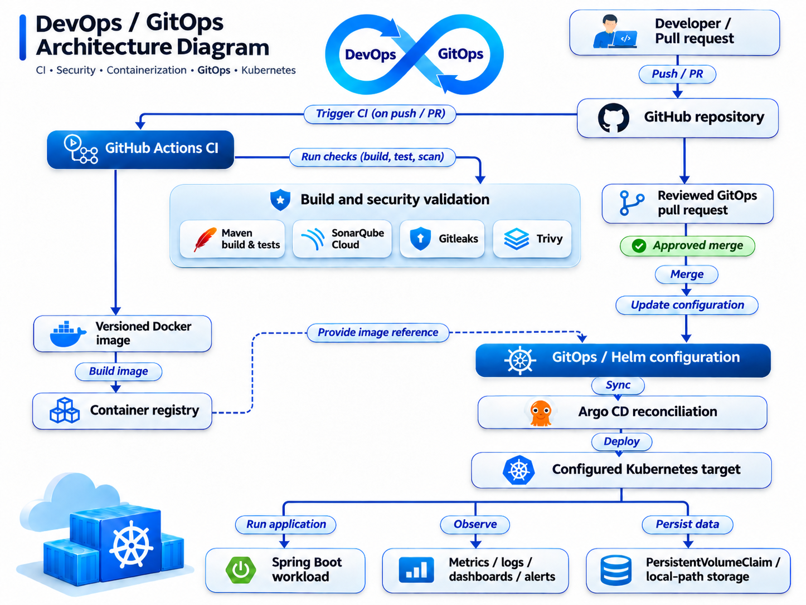

Continuous integration validates code and creates a traceable container artifact. A reviewed change to the GitOps deployment configuration authorizes a release; **Argo CD** reconciles the approved desired state with Kubernetes according to its configured synchronization policy. Mandatory checks and approval requirements depend on repository settings.

### 2. Hybrid Kubernetes infrastructure

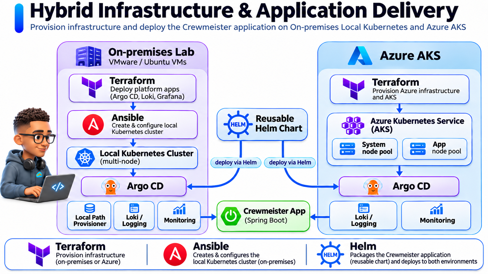

- **On-premises VMware:** Kubernetes host and cluster preparation automated with Ansible.
- **Azure AKS:** Managed Kubernetes infrastructure described with Terraform.
- **Helm + Argo CD:** Reusable application packaging and declarative Kubernetes deployment across environments, with separate configuration values where required.

---

## Docker & Docker Compose

The root [`Dockerfile`](Dockerfile) packages the application as a container image. [`compose.yaml`](compose.yaml) defines the local multi-container environment for development and troubleshooting.

```bash
# Validate configuration (avoid exposing rendered secret values)
docker compose config --quiet

# Build and start services
docker compose up --build -d

# Inspect running services and recent logs
docker compose ps
docker compose logs --tail=80
```

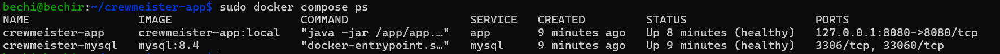

**Container and secret-management practices:** Use `.env.example` for placeholder variable names, exclude sensitive `.env` files, avoid embedding credentials in images, tag images with a source revision, and configure health checks and resource limits where supported.

---

## On-Premises Kubernetes with Ansible

The VMware-based Kubernetes environment uses Ubuntu VMs. Ansible organizes provisioning into an inventory, playbooks, variables, and reusable roles rather than a sequence of manual installation commands.

**Implementation:** [`crewmeister-k8s-ansible/`](crewmeister-k8s-ansible/)

| Component | Responsibility |
| --- | --- |
| `inventory.yml` | Control-plane and worker inventory |
| `ansible.cfg` | Ansible execution settings |
| `preflight.yml` | Prerequisite checks |
| `site.yml` | Main cluster automation playbook |
| `roles/` | Reusable cluster automation roles |
| `group_vars/` | Shared, non-secret settings |
| `fetch-kubeconfig.yml` | Kubernetes client configuration retrieval |
| `reset-cluster.yml` | Intentional cluster reset operations |

**Validate the Ansible configuration:**

```bash
cd crewmeister-k8s-ansible
ansible-inventory -i inventory.yml --graph
ansible-playbook -i inventory.yml site.yml --syntax-check
ansible-playbook -i inventory.yml site.yml --list-tasks
cd ..
```


**Check the local cluster** (adjust the kubeconfig location to your workstation):

```bash
KUBECONFIG="$HOME/.kube/crewmeister-admin.conf" kubectl get nodes -o wide
KUBECONFIG="$HOME/.kube/crewmeister-admin.conf" kubectl get pods -A -o wide --sort-by=.spec.nodeName
```

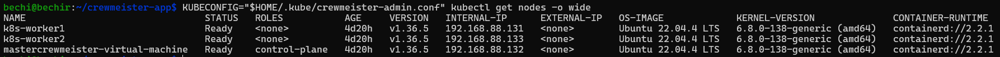

Ansible improves reproducibility and makes it easier to review configuration changes, parameterize hosts, and diagnose setup failures. Successful provisioning should still be verified by healthy nodes and workloads.

---

## Azure AKS with Terraform

Terraform describes the cloud infrastructure for **Azure Kubernetes Service (AKS)**. The design distinguishes a **system node pool**, intended for cluster services, from a **user node pool**, intended for application workloads. Verify the actual deployed node pools before presenting the design as a live environment.

**Implementation:** [`terraform/`](terraform/)

### Infrastructure design

- Reusable configuration and variables allow environment-specific input values.
- `terraform plan` makes proposed infrastructure changes reviewable.
- State and backend credentials must be kept out of source control.
- An Azure Storage (`azurerm`) remote backend is suitable for collaborative state and locking, **but should only be claimed as implemented if the repository actually configures it**.

```bash
cd terraform
terraform fmt -check -recursive
terraform init
terraform validate
terraform plan
cd ..
```

`terraform plan` previews proposed changes; it is **not** proof that Azure resources were deployed. To confirm an existing AKS cluster, use the kubeconfig and Azure configuration appropriate to your environment:

```bash
kubectl --kubeconfig="$HOME/.kube/crewmeister-aks" get nodes -L agentpool
kubectl --kubeconfig="$HOME/.kube/crewmeister-aks" get pods -A -o wide
```

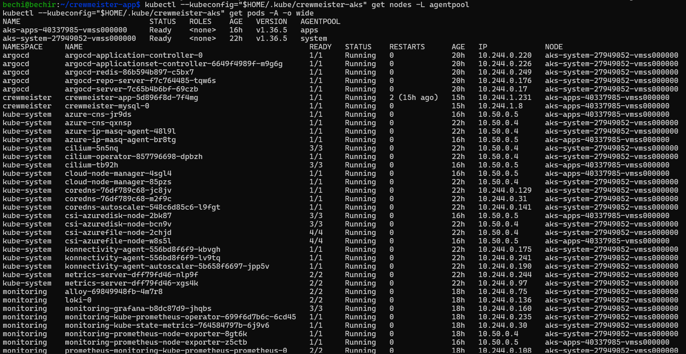

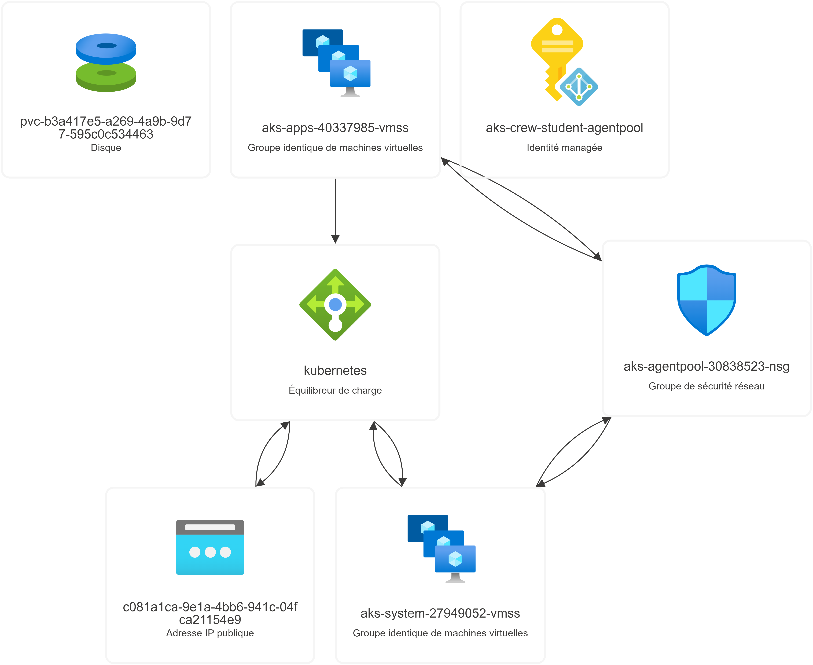

---

## GitHub Actions — DevSecOps Pipeline

GitHub Actions coordinates builds, tests, code quality, security scanning, and image publication. Whether individual checks actually block a merge or deployment depends on workflow failure handling and branch protection.

| Stage | Technology | Evidence |
| --- | --- | --- |
| Build and tests | Maven | Workflow logs and Surefire reports, when generated |
| Code quality | SonarQube Cloud | Analysis results and quality-gate status |
| Secret detection | Gitleaks | Scan output or uploaded report, if configured |
| Vulnerability scanning | Trivy | Findings for the configured target and severity threshold |
| Container packaging | Docker | Image build logs and immutable version/tag |
| Image publication | Container registry | Published tag or digest |

**Security principles:**

- Run configured tests and scans before promoting an image.
- Require important status checks and suitable nonzero exit behavior where enforcement is needed.
- Store tokens and credentials in appropriate secret stores or use short-lived identities.
- Correlate source commit, scan results, container digest, and GitOps revision.
- Describe reports as downloadable artifacts only if the workflow uploads them.

**Implementation:** [Workflow definitions](.github/workflows/) · [GitHub Actions runs](https://github.com/bechirjw/crewmeister-app/actions)

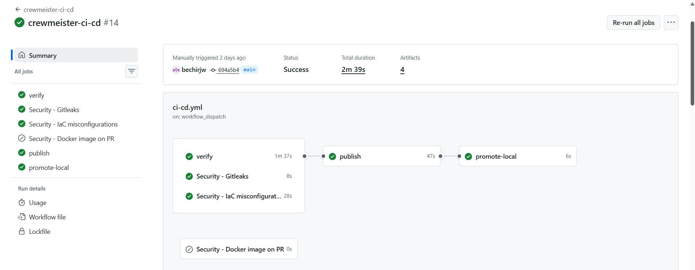

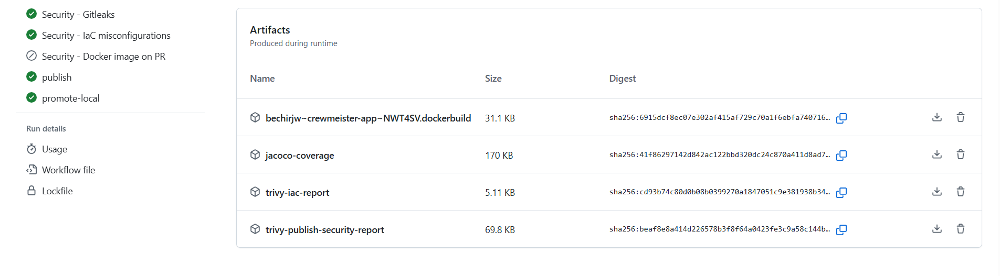

---

## Helm & Argo CD GitOps

**Helm** packages Kubernetes manifests as parameterized templates. **Argo CD** tracks desired state in Git and reconciles the target cluster in accordance with its configured synchronization and access policies.

**Implementation:** [`helm/crewmeister/`](helm/crewmeister/) · [`gitops/`](gitops/)

```bash
# From the repository root: validate the chart and render manifests
helm lint helm/crewmeister -f helm/crewmeister/values-local.yaml
helm template crewmeister helm/crewmeister -f helm/crewmeister/values-local.yaml

# Inspect deployments (requires a configured Kubernetes context)
kubectl get applications.argoproj.io -A
kubectl get pods -A -o wide
```

### Review-controlled release flow

1. CI builds the application, runs its configured tests and security analyses, and publishes the versioned image when the configured conditions pass.
2. The image reference or Helm configuration is updated in the GitOps repository.
3. A pull request is reviewed and passes any required checks before merging, **if repository rules enforce that review**.
4. Argo CD observes the approved revision and reconciles Kubernetes according to the application's sync policy.
5. Operators verify the deployed image, rollout health, and Argo CD synchronization state.

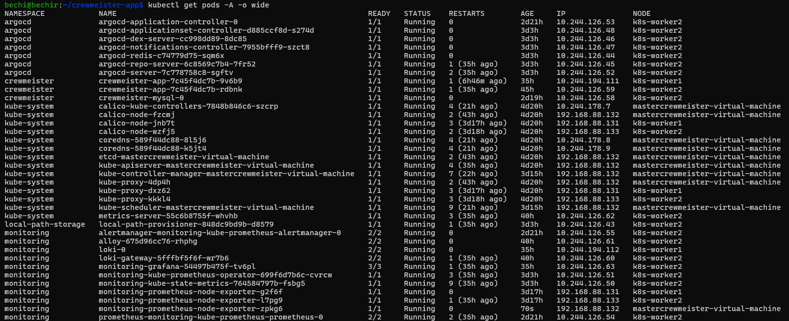

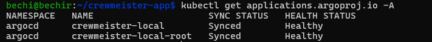


The key distinction is **validated artifact versus authorized deployment**: a successful image build does not by itself grant permission to deploy.

---

## Monitoring, Logging & Alerting

The observability layer aims to answer three questions: **Is the platform healthy? What failed? Who needs to act?**

| Capability | Components / approach | What to demonstrate |
| --- | --- | --- |
| Monitoring | Kubernetes metrics and Grafana dashboards where configured | CPU, memory, and workload status |
| Centralized logging | Loki and the configured log collector | Searchable application and cluster logs |
| Alerting | Grafana Alerting or Alertmanager, where deployed | Rules, firing/resolution state, and tested notifications |

Check the deployed monitoring components:

```bash
kubectl get pods -A | grep -Ei 'grafana|prometheus|loki|alertmanager'
kubectl get svc -A | grep -Ei 'grafana|prometheus|loki|alertmanager'
kubectl top nodes  # Requires a working metrics API
```

Confirm the metrics collector, Loki ingestion agent, and notification receiver in actual deployment manifests before claiming that an integration is operational. A Grafana dashboard alone does not demonstrate working alert notifications.

### Additional observability screenshots


---

## Persistent Storage — Local Path Provisioner

For the on-premises cluster, **Local Path Provisioner** can dynamically provision node-local PersistentVolumes from Kubernetes PersistentVolumeClaims.

```bash
KUBECONFIG="$HOME/.kube/crewmeister-admin.conf" kubectl get storageclass
KUBECONFIG="$HOME/.kube/crewmeister-admin.conf" kubectl get pvc -A
KUBECONFIG="$HOME/.kube/crewmeister-admin.conf" kubectl get pv
KUBECONFIG="$HOME/.kube/crewmeister-admin.conf" kubectl get pods -n local-path-storage
```

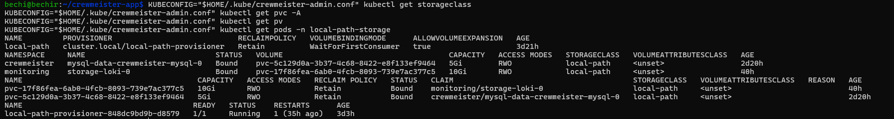

**Trade-off:** node-local volumes do not automatically provide replication or high availability. A `Bound` PVC proves binding, not end-to-end data durability; use a separate write/read test to verify persistence.

---

## Application & API Testing


With the application running and port-forwarded to `127.0.0.1:18080`, perform an HTTP smoke test:

```bash
curl -sS -w '\nHTTP %{http_code}\n' \
  'http://127.0.0.1:18080/user?id=1'
```


---

## Repository Structure

```text
crewmeister-app/
├── .github/workflows/          # GitHub Actions workflows
├── crewmeister-k8s-ansible/    # On-premises Kubernetes automation
├── terraform/                  # Azure AKS Infrastructure as Code
├── helm/crewmeister/           # Application Helm chart
├── gitops/                     # Argo CD / GitOps manifests
├── docs/screenshots/           # Evidence referenced by this README
├── src/                       # Spring Boot source and tests
├── Dockerfile                 # Container build
├── compose.yaml               # Local Docker Compose definition
├── pom.xml                    # Maven project definition
├── INSTALL.md                 # Installation instructions
└── README.md                  # Project overview
```

## Evidence & Documentation

| Evidence | What it demonstrates |
| --- | --- |
| On-premises nodes and Ansible | Automated cluster configuration and node readiness |
| AKS node pools and Terraform | Azure infrastructure architecture and scheduling topology |
| GitHub Actions and scanner results | CI execution, testing, quality, and security analysis |
| Pull request and Argo CD | Deployment review, reconciliation, and application health |
| Grafana and Loki | Workload metrics and centralized log analysis |
| PVC status and HTTP test | Storage provisioning and application response |

Images are referenced relative to this root README, for example:

```markdown

```

Image filenames are case-sensitive. Ensure each screenshot exists under `docs/screenshots/` and does not expose passwords, tokens, kubeconfigs, or private keys.


## Quick Verification

```bash
# Confirm the active Kubernetes context before making changes
kubectl config current-context

# Inspect infrastructure and workloads
kubectl get nodes -o wide
kubectl get pods -A -o wide --sort-by=.spec.nodeName

# Validate chart rendering without deployment
helm lint helm/crewmeister -f helm/crewmeister/values-local.yaml
```

> **Security:** Never commit passwords, API tokens, kubeconfigs, private keys, Terraform state, `.env` files containing secrets, or unredacted screenshots. Execute Terraform apply, Ansible reset/provisioning, and Kubernetes mutations only after verifying the intended target environment.

---

**Infrastructure as Code · Security-Aware CI · Review-Controlled GitOps · Observable Kubernetes**

*Crewmeister DevSecOps engineering project*
